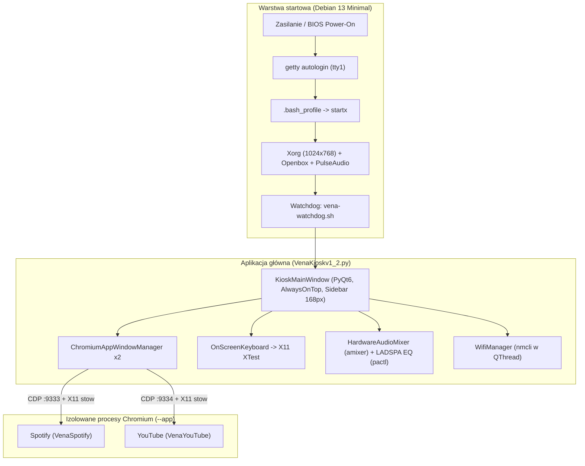

# VENA V-Speaker (Pilot V)


Autonomiczny system kioskowy audio/wideo dla terminala cienkiego **Fujitsu Futro S930** z ekranem dotykowym **1024×768**. System pracuje jako dedykowany appliance pod **Debianem 13** (bez pełnego środowiska graficznego pulpitu), łącząc nakładkę dotykową w **PyQt6** z dwiema niezależnymi instancjami przeglądarki **Chromium** (Spotify i YouTube) sterowanymi przez protokół **CDP** oraz manipulację oknami **X11**.

> **Zakres odpowiedzialności:** Projekt został zrealizowany we współpracy z kolegą. Odpowiadałem **wyłącznie za stronę informatyczną** (aplikacja w Pythonie/PyQt6, integracja z X11 i CDP, konfiguracja systemu Debian/Openbox oraz toru audio).

---

## Architektura systemu

Po włączeniu zasilania terminal przechodzi bezpośrednio z `getty autologin` do sesji X11/Openbox uruchamiającej skrypt nadzorujący [`vena-watchdog.sh`](VenaKioskv1_0/vena-watchdog.sh). Główna aplikacja [`VenaKioskv1_2.py`](VenaKioskv1_0/VenaKioskv1_2.py) renderuje stały pasek boczny (`168 px`, `AlwaysOnTop`), zarządza procesami Chromium przez WebSocket CDP (`9333` i `9334`), kontroluje geometrię okien przez `python-xlib` oraz deleguje operacje audio i sieciowe do narzędzi systemowych.



---

## Kluczowe rozwiązania i kompromisy inżynierskie

| Wyzwanie | Rozwiązanie w systemie | Kompromis / Trade-off |
|---|---|---|
| **Niestabilność Chromium przy `X11 unmap/map`** | Zamiast ukrywania okna (`unmap`), nieaktywna instancja jest przesuwana poza ekran (`APP_STOW_X = 1088`), a `POWRÓT` jedynie chowa okno. | Oba procesy Chromium pozostają w pamięci RAM przez cały czas pracy kiosku, zapewniając natychmiastowe przełączanie bez utraty dźwięku. |
| **Zimny start web-appów na thin clencie** | Preload obu procesów zaraz po starcie UI (Spotify ~1,5 s, YouTube ~3,5 s) oraz pauzowanie odtwarzacza w tle przez CDP dopiero wtedy, gdy nowy strumień faktycznie zacznie grać (`_watch_active_media`). | Wyższe obciążenie CPU/RAM tuż po uruchomieniu w zamian za brak opóźnień przy pierwszym wyborze kafelka. |
| **Brak klawiatury dotykowej działającej nad `AlwaysOnTop`** | Autorska klawiatura ekranowa w PyQt (`WA_ShowWithoutActivating`), która wstrzykuje zdarzenia klawiszy do aktywnego okna Chromium przez rozszerzenie **X11 XTest**. | Ścisłe powiązanie z serwerem X11 — brak możliwości prostego przeniesienia na Wayland bez przepisania warstwy wejścia. |
| **Zabezpieczenie głośnika przed przesterowaniem** | Tor audio oparty na `amixer` (debouncing suwaka `35 ms`) oraz korektorze wielopasmowym PulseAudio `module-ladspa-sink` (`mbeq_1197`) z limitem pasm 50–220 Hz `<= 0 dB`. | Presety (*Party, Disco, Bass, Chill, Normal*) kształtują brzmienie przez tłumienie pozostałych pasm zamiast podbijania basu. |
| **Izolacja sesji przeglądarki w kiosku** | Odpytywanie CDP co `2 s` w celu blokady nawigacji poza dozwolone domeny, zamykania pop-upów i wymuszania wyjścia z HTML5 fullscreen (żeby sidebar pozostał widoczny). | Ręczny klient WebSocket w stdlib wołany z wątku UI (świadomie pozostawione zgodnie z [`DECISIONS.md`](VenaKioskv1_0/DECISIONS.md)). |
| **Utrzymanie stabilności inicjalizacji X11/Openbox** | Cały kod produkcyjny utrzymany świadomie w jednym pliku [`VenaKioskv1_2.py`](VenaKioskv1_0/VenaKioskv1_2.py) (`5868` linii) zamiast dzielenia na pakiet. | Trudniejsza nawigacja po pliku w zamian za brak regresji w kolejności startu `Display()`, timerów Qt i reguł Openbox. |

---

## Środowisko docelowe

| Komponent | Konfiguracja produkcyjna |
|---|---|
| **Hardware** | Fujitsu Futro S930 (AMD GX / Radeon HD), ekran dotykowy 1024×768 (DisplayPort) |
| **System** | Debian 13 (Trixie) minimal, konfiguracja appliance bez pełnego pulpitu |
| **Grafika** | X11 (Xorg) + Openbox (marginesy `0`, brak dekoracji okien) |
| **Audio** | ALSA + PulseAudio + plugin LADSPA (`mbeq_1197`) |
| **Sieć** | Ethernet + karta Wi-Fi USB TP-Link TL-WN725N (`rtl8xxxu`), obsługa przez `nmcli` |
| **Nadzór** | Pętla `vena-watchdog.sh` + wewnętrzny health/watchdog timer w Pythonie |

---

## Uruchomienie (Linux / Debian)

Na docelowym systemie zależności Pythona instalowane są z repozytoriów systemowych (`apt`), aby uniknąć problemów z wtyczkami Qt:

```bash
sudo apt update
sudo apt install -y python3-pyqt6 python3-xlib chromium pulseaudio alsa-utils openbox network-manager
```

Alternatywnie z `pip` (zobacz [`VenaKioskv1_0/requirements.txt`](VenaKioskv1_0/requirements.txt)):

```bash
pip install -r VenaKioskv1_0/requirements.txt
python3 VenaKioskv1_0/VenaKioskv1_2.py
```

Pełna instrukcja odtworzenia środowiska od czystego Debiana znajduje się w [`VenaKioskv1_0/naLinux.md`](VenaKioskv1_0/naLinux.md).

---

## Dokumentacja techniczna

Wszystkie dokumenty projektowe znajdują się w katalogu [`VenaKioskv1_0/`](VenaKioskv1_0/):

| Dokument | Zawartość |
|---|---|
| [`ARCHITECTURE.md`](VenaKioskv1_0/ARCHITECTURE.md) | Warstwy systemu, przepływ danych, tabela timerów i pliki runtime |
| [`DECISIONS.md`](VenaKioskv1_0/DECISIONS.md) | Rejestr decyzji architektonicznych (ADR) i uzasadnienia kompromisów |
| [`naLinux.md`](VenaKioskv1_0/naLinux.md) | Przewodnik instalacji i konfiguracji systemu na terminale Futro |
| [`PROJECT_MAP.md`](VenaKioskv1_0/PROJECT_MAP.md) | Mapa klas, wątków i odpowiedzialności w `VenaKioskv1_2.py` |
| [`TROUBLESHOOTING.md`](VenaKioskv1_0/TROUBLESHOOTING.md) | Diagnostyka typowych usterek (X11, Chromium, audio, sieć) |
| [`DEVELOPMENT.md`](VenaKioskv1_0/DEVELOPMENT.md) | Zasady wprowadzania zmian i debugowania na urządzeniu |
