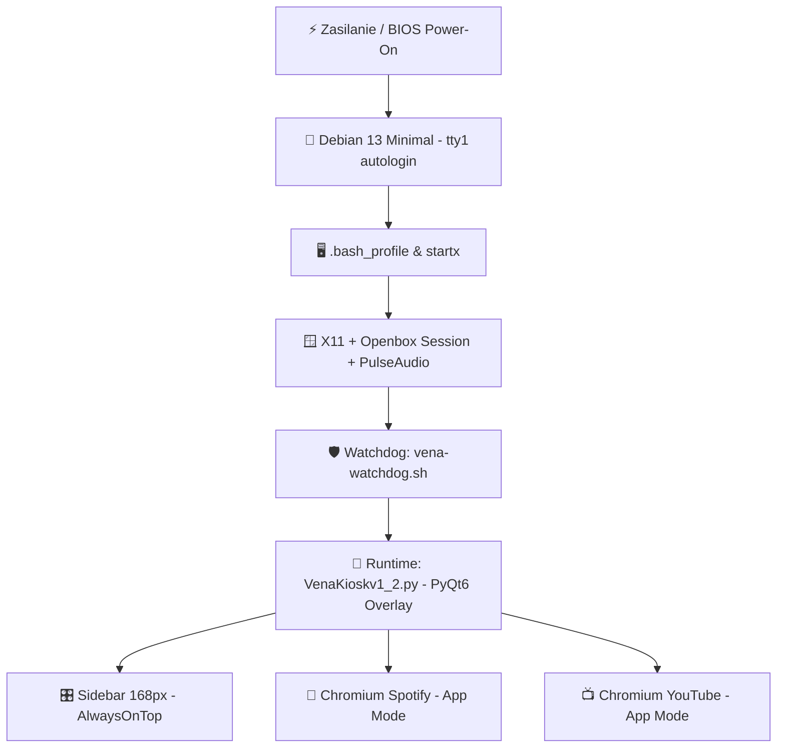

# 🎵 VENA V-Speaker (Pilot V) — Embedded Linux Kiosk System

[](VenaKioskv1_0/VenaKioskv1_2.py)
[](VenaKioskv1_0/VenaKioskv1_2.py)
[](VenaKioskv1_0/naLinux.md)
[](VenaKioskv1_0/README.md)
[](VenaKioskv1_0/ARCHITECTURE.md)
[]()

Dedykowany system kioskowy audio/wideo zaprojektowany na terminal cienki (**Thin Client Fujitsu Futro S930**) z ekranem dotykowym **1024×768**. System działa w trybie **standalone appliance** (bez pełnego środowiska graficznego desktopu), łącząc nakładkę interfejsu dotykowego w **PyQt6** z dwiema niezależnymi instancjami przeglądarki **Chromium** (dla Spotify i YouTube), sterowanymi przez protokół **CDP** oraz warstwę okien **X11**.

---

## 🏗️ Architektura Systemu — Od Startu do UI

System został zoptymalizowany pod kątem natychmiastowego startu po zaniku zasilania (*Power Failure Recovery*), pełnej izolacji procesów oraz ciągłej pracy bez nadzoru:



---

## ⚡ Kluczowe Rozwiązania Inżynieryjne

### 1. Zarządzanie Mediami i Protokół CDP (Chrome DevTools Protocol)
* Aplikacje multimedialne (Spotify, YouTube) działają w dedykowanych procesach Chromium w trybie `--app`, kontrolowanych przez WebSocket na lokalnych portach (`9333` i `9334`).
* **Polityka bezpieczeństwa:** Automatyczna blokada wychodzenia poza dozwolone domeny (ochrona przed przekierowaniami i reklamami) oraz zapobieganie wyskakiwaniu okien pop-up.
* **Koordynacja odtwarzaczy:** Precyzyjne wykrywanie aktywnego strumienia audio przez CDP — odtwarzacz w tle jest automatycznie pauzowany dopiero w momencie, gdy nowo wybrany gracz rzeczywiście rozpocznie odtwarzanie.

### 2. Zaawansowane Sterowanie Oknami X11 (`python-xlib`)
* **Stow vs Unmap:** Tradycyjne ukrywanie okien (`unmap`) w Chromium prowadzi do niestabilności i restartów. W VENA okna nieaktywne są przesuwane poza widoczny obszar ekranu (`APP_STOW_X = 1088`), dzięki czemu procesy pozostają aktywne w pamięci, a przełączanie między Spotify a YouTube jest natychmiastowe.
* **Wirtualna klawiatura ekranowa:** Autorski moduł klawiatury dotykowej PyQt wstrzykujący zdarzenia klawiaturowe bezpośrednio do aktywnego okna Chromium przy użyciu rozszerzenia **X11 XTest**.

### 3. Wielowarstwowy Tor Audio i DSP
* **Mikser ALSA:** Bezpośrednia komunikacja z `amixer` z debouncingiem (35 ms) do płynnej regulacji głośności suwakiem bez przeciążania procesora.
* **Efekty dźwiękowe LADSPA:** Cyfrowa korekcja dźwięku w czasie rzeczywistym z wykorzystaniem modułu korektora wielopasmowego `module-ladspa-sink` (`mbeq_1197`). Predefiniowane profile akustyczne: *Party, Disco, Bass, Chill, Normal*. Zabezpieczenie pasm niskich częstotliwości przed przesterowaniem wzmacniacza.

### 4. Niezawodność i Diagnostyka
* **Dwustopniowy Watchdog:** Skrypt powłoki [`vena-watchdog.sh`](VenaKioskv1_0/vena-watchdog.sh) monitoruje proces główny Pythona, a wewnętrzne timery aplikacji nadzorują stan pamięci, procesy Chromium oraz łączność sieciową.
* **Wielowątkowy menedżer Wi-Fi:** Obsługa skanowania i łączenia z sieciami bezprzewodowymi przez `nmcli` w osobnym wątku `QThread` (brak zamrażania dotykowego interfejsu użytkownika podczas negocjacji DHCP).
* **Ukrywanie kursora na ekranie dotykowym:** Przezroczysta pixmapa X11 oraz override kursora Qt, zapobiegające pojawianiu się strzałki myszy przy dotyku, zachowując pełną propagację zdarzeń pointera.

---

## 🖥️ Środowisko Sprzętowo-Systemowe

| Komponent | Specyfikacja produkcyjna |
|---|---|
| **Terminal bazowy** | Fujitsu Futro S930 (AMD GX / Radeon HD) |
| **Wyświetlacz** | 1024×768 (DisplayPort, wymuszona rozdzielczość sesji X) |
| **System operacyjny** | Debian 13 (Trixie), konfiguracja appliance bez desktopu |
| **Serwer grafiki** | X11 (Xorg) + Openbox WM (brak dekoracji okien, marginesy zerowe) |
| **Stos Audio** | PulseAudio + ALSA + LADSPA EQ Plugin |
| **Sieć** | Zintegrowany Ethernet + karta Wi-Fi USB TP-Link TL-WN725N (`rtl8xxxu`) |
| **Autostart** | getty autologin &rarr; startx &rarr; Openbox autostart &rarr; Watchdog loop |

---

## 📂 Struktura Projektu i Dokumentacja

```text
├── VenaKioskv1_0/
│   ├── VenaKioskv1_2.py          # Główny kod produkcyjny kiosku (PyQt6 + X11 + CDP)
│   ├── vena-watchdog.sh          # Skrypt watchdoga pilnujący ciągłości działania aplikacji
│   ├── requirements.txt          # Zależności Python (PyQt6, python-xlib)
│   │
│   ├── ARCHITECTURE.md           # Szczegółowy opis architektury, przepływu danych i timerów
│   ├── DECISIONS.md              # Rejestr decyzji inżynieryjnych (ADR)
│   ├── DEVELOPMENT.md            # Wytyczne deweloperskie i procedury testów smoke
│   ├── naLinux.md                # Kompletny przewodnik instalacji od czystego Debiana
│   ├── PROJECT_MAP.md            # Indeks klas, wątków i komponentów w kodzie
│   ├── TROUBLESHOOTING.md        # Procedury diagnozy problemów i kodów błędów
│   └── TODO.md                   # Otwarte punkty rozwoju i notatki
│
└── README.md                     # Główny portal dokumentacyjny repozytorium
```

---

## 📚 Przewodniki Techniczne

Szczegółowa dokumentacja poszczególnych modułów systemu:
* 🏛️ **[Architektura i Przepływ Danych (ARCHITECTURE.md)](VenaKioskv1_0/ARCHITECTURE.md)**
* 💡 **[Decyzje Projektowe i Kompromisy (DECISIONS.md)](VenaKioskv1_0/DECISIONS.md)**
* 🐧 **[Instalacja i Odtworzenie Maszyny od Zera (naLinux.md)](VenaKioskv1_0/naLinux.md)**
* 🛠️ **[Diagnostyka i Rozwiązywanie Problemów (TROUBLESHOOTING.md)](VenaKioskv1_0/TROUBLESHOOTING.md)**
* 🗺️ **[Mapa Klas i Komponentów Kodu (PROJECT_MAP.md)](VenaKioskv1_0/PROJECT_MAP.md)**

---

<p align="center">
  <sub>Projekt zrealizowany jako dedykowany system multimedialny embedded dla terminali cienkich.</sub>
</p>
